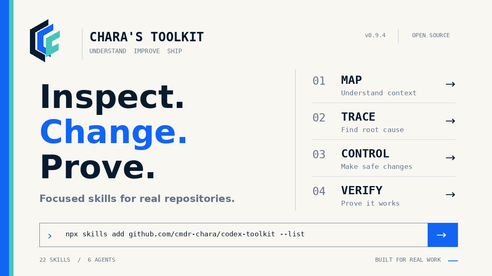

# Chara's Toolkit

**Better engineering, any agent.**

28 engineering skills for coding agents, with optional workflow tooling for Codex.

[Guida in italiano](docs/guida-italiano.md)

[](https://github.com/cmdr-chara/chara-toolkit/actions/workflows/ci.yml)
[](LICENSE)

<p align="center">
  
</p>

Chara's Toolkit gives coding agents focused instructions for understanding repositories, finding bugs, changing code safely, and proving that a change works. Each skill is a self-contained `SKILL.md` folder in the open Agent Skills format, so it works with Codex, Claude Code, Cursor, Gemini CLI, GitHub Copilot, and other compatible agents. Six optional Mission Control roles for delegating work to subagents work on every agent, and Codex users also get toolkit routing.

## Choose your setup

### Full toolkit

Requires **Node.js 18+**.

```sh
npx --yes github:cmdr-chara/chara-toolkit setup
```

This installs:

- all 28 skills into the standard `~/.agents/skills` folder (read by Codex, Cline, Warp, Zed, Pi, and other agents that follow the standard);
- the same skills into every other agent it finds on your machine: Claude Code (`~/.claude/skills`), Cursor, Gemini CLI, GitHub Copilot, OpenCode, Windsurf, Factory Droid, Kiro CLI, Roo Code, and Goose;
- six optional Mission Control roles as native subagents for Codex, Claude Code (`~/.claude/agents`), and Gemini CLI (`~/.gemini/agents`); every other agent gets them as role cards inside the delegation skill;
- for Codex: workflow routing and the managed `AGENTS.md` instructions;
- a user-level updater that follows published GitHub releases.

Choose agents explicitly with `--agents`, for example `--agents claude-code,cursor` or `--agents codex`. Earlier releases installed skills into `~/.codex/skills`, which Codex now treats as deprecated; setup moves the toolkit's copies from there into the backup folder so Codex does not list them twice, and leaves your own skills alone.

Prefer a global command?

```sh
npm install --global github:cmdr-chara/chara-toolkit
chara setup
```

`codex-toolkit` remains a compatibility alias for `chara`.

### One skill only

Browse the catalog:

```sh
npx skills add https://github.com/cmdr-chara/chara-toolkit --list
```

Install one skill for a compatible agent at user level. Replace `codex` with the agent you use (for example `claude-code` or `cursor`):

```sh
npx skills add https://github.com/cmdr-chara/chara-toolkit \
  --skill repository-intelligence -g -a codex
```

This uses the portable `SKILL.md` format. It does not install the full toolkit routing layer, Mission Control roles, or the updater. See the [portability guide](docs/portable-skills.md) for client-specific details.

## Start using it

Start a **new session** in your agent and describe the result you want. The agent picks the smallest relevant skill from its description; you usually do not need to name one.

Codex users can inspect the Codex integration with:

```sh
npx --yes github:cmdr-chara/chara-toolkit mission-control check
```

```text
Find important bugs in this repository, fix them, and verify the changes.
```

```text
This API is slow. Measure the bottleneck, improve it, and compare the results.
```

```text
Review this authentication change and report only security issues that can be verified from the code.
```

Your project's `AGENTS.md` remains higher priority than general toolkit guidance. Skills guide the agent; your host still controls files, tools, network access, and approvals.

## Skill catalog

| Skill | Use it for |
| --- | --- |
| `repository-intelligence` | Map architecture, ownership, dependencies, hotspots, and change impact. |
| `bug-finder` | Hunt for previously unknown correctness defects and prove or retire candidates. |
| `debugging-investigator` | Reproduce a concrete failure, trace its cause, and design a focused fix. |
| `review-and-refactor-code` | Review PRs with verified findings and bounded re-review, or plan behavior-preserving refactors. |
| `security-review` | Trace trust boundaries and assess exploitable security flaws. |
| `optimize-codebase-performance` | Measure a named bottleneck and compare a bounded optimization. |
| `codebase-evolution-controller` | Plan dependency, API, schema, and framework transitions with rollback paths. |
| `codebase-improvement-planner` | Discover and rank evidence-backed repository improvements. |
| `documentation-synchronizer` | Keep user, developer, API, migration, and operations docs aligned with code. |
| `verification-and-release` | Decide what must be verified and whether an integrated change is ready to ship. |
| `completion-proof` | Prove substantial scoped work is actually finished: done contract, coverage accounting, final-candidate rechecks, and evidence-bound claims. |
| `toolchain-preflight` | Resolve local shell, runtime, package-manager, and browser blockers. |
| `typescript-quality-enforcer` | Improve TypeScript and JavaScript type safety and lint discipline. |
| `rust-engineering` | Implement bounded Rust changes and ports with API, ownership, compatibility, and supported-configuration evidence. |
| `kotlin-engineering` | Implement Kotlin libraries/apps and ports, with conditional coroutines/Flow, Android/Compose, and KMP guidance. |
| `python-engineering` | Implement Python modules, services, bots, scripts, and ports with API, resource, environment, and packaging evidence. |
| `cpp-engineering` | Implement C++ changes and ports with lifetime/ABI contracts, native build checks, and conditional Qt/QML guidance. |
| `swift-engineering` | Implement Swift packages and native bridges with ARC/isolation contracts and conditional Apple/Metal checks. |
| `go-engineering` | Implement Go packages, services, CLIs, and ports with context, goroutine, error, and module contracts. |
| `production-web-builder` | Build or audit production web interfaces. |
| `screenshot-to-interface` | Reconstruct maintainable interfaces from visual references. |
| `product-design-director` | Define UX, visual direction, accessibility, and responsive behavior. |
| `mobile-architecture-director` | Choose a mobile architecture from evidence and constraints. |
| `flutter-production-builder` | Build or audit production Flutter applications. |
| `expo-react-native-builder` | Build or audit production Expo and React Native applications. |
| `delegate-with-mission-cards` | Split independent work into bounded missions with explicit ownership. |
| `multi-agent-work-coordinator` | Coordinate safe parallel work across non-overlapping resources. |
| `content-provenance-hygiene` | Inspect and sanitize authorized metadata and provenance surfaces. |

### Evidence-first pull request review

Use `review-and-refactor-code` with a specific PR or diff. It now adjusts review depth to risk, validates suspected bugs against real code paths, distinguishes introduced from pre-existing issues, and stops agent fix/review cycles after three substantive rounds. Findings begin with a count, including zero when supported by the inspected scope.

The [PR review protocol](skills/review-and-refactor-code/references/pr-review-protocol.md) defines the workflow. The [opt-in policy guide](skills/review-and-refactor-code/references/review-policy-template.md) includes a `REVIEW.md` example and adoption guidance. Chara's Toolkit itself now includes [`REVIEW.md`](REVIEW.md) and a [pull-request template](.github/PULL_REQUEST_TEMPLATE.md).

This is a skill upgrade, not an automatically installed review bot, enforced GitHub protection, or human approval. The existing security and release specialists retain their responsibilities.

### Language implementation and review

Use `rust-engineering` for a Rust crate change or a bounded port after Rust is selected. It preserves consumer APIs and the supported input domain, examines ownership and cancellation where relevant, and selects checks from the crate's declared toolchain, features, and targets. Detailed guidance loads only when needed. Rust reviews use the existing reviewer with its [Rust checklist](skills/review-and-refactor-code/references/rust-review.md); operational migrations remain with the evolution specialist.

Kotlin, Python, C++, Swift, and Go have the same implementation/review ownership split, with their own runtime and compatibility guidance. Kotlin does not imply Android, Swift does not imply an Apple-only module, and C++ does not imply Qt. Framework references load only for the changed boundary. JavaScript/TypeScript and Flutter/Dart remain covered by the existing web/mobile and type-quality specialists. A language mention alone does not override review, debugging, migration, or release ownership.

The [Rust evaluation guide](evaluations/rust-engineering.md) defines implementation and review probes with independent acceptance criteria. Structural validation and individual probes do not establish a comparative model-quality improvement.
The [language evaluation guide](evaluations/language-engineering.md) covers the additional five routes and keeps executable probes, source-level observations, and unavailable platform checks distinct.

The machine-readable catalog is in [`skills/llms.txt`](skills/llms.txt). The six optional roles are `architect-writer`, `builder-writer`, `investigator-reader`, `patcher-writer`, `pathfinder-reader`, and `sentinel-reader`. Read-only roles are enforced by a tool allowlist in Claude Code and Gemini CLI; in Codex and other agents they are enforced by instructions, because Codex custom agents inherit the parent session's sandbox.

## What works where

| Capability | Full toolkit | Individual skills |
| --- | --- | --- |
| Individual `SKILL.md` folders | Included | Installable in compatible clients |
| Natural-language routing across the toolkit | Codex integration | Client selects installed skills |
| Mission Control roles | Native in Codex, Claude Code, Gemini CLI; role cards elsewhere | Role cards with `delegate-with-mission-cards` |
| Workflow orchestration | Codex integration | Not included |
| Toolkit updater and managed `AGENTS.md` block | Codex integration | Not included |

The skill folders provide instructions, references, and scripts. They do not grant runtime permissions, API keys, or network access.

## Options and updates

Preview a setup without changing files:

```sh
npx --yes github:cmdr-chara/chara-toolkit setup --dry-run
```

Install without registering a scheduled updater:

```sh
npx --yes github:cmdr-chara/chara-toolkit setup --no-auto-update
```

With a global install, manage the updater with:

```sh
chara auto-update status
chara auto-update remove
chara auto-update install
```

Use `--agents <list>` to choose agents, `--home /path` to install under a different home folder, and `--codex-home /path/to/codex` when Codex uses a non-default home. The setup preserves instructions outside its managed `AGENTS.md` block and backs up managed files before replacement.

## Documentation

- [Guida in italiano: installazione e uso](docs/guida-italiano.md)
- [Portability guide](docs/portable-skills.md) · [Skill catalog](skills/llms.txt)
- [Workflow routing](orchestration/workflows.md) · [Responsibility matrix](docs/responsibility-matrix.md)
- [Automatic updates](docs/auto-update.md) · [Enterprise deployment](docs/enterprise-deployment.md)
- [Application verification](docs/project-verification.md) · [Destructive-operation safety](docs/destructive-operations-safety.md)
- [Evaluations](evaluations/README.md) · [Contributing](CONTRIBUTING.md) · [Changelog](CHANGELOG.md)
- [Security reporting](SECURITY.md)

## License

[MIT](LICENSE) © 2026 cmdr-chara. All skills, references, scripts, and bundled lint rules are original work.
